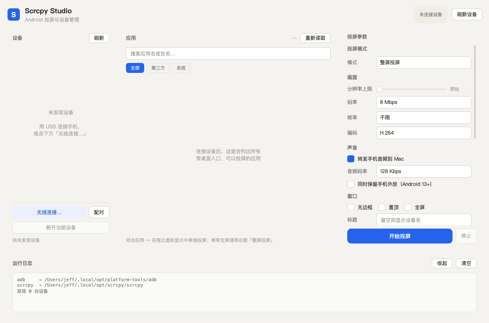
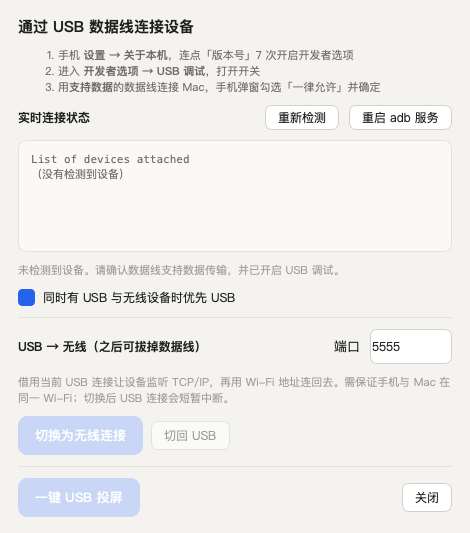

# Scrcpy Studio

macOS 桌面程序：集中管理 adb / scrcpy，用**手机桌面**的方式浏览手机上所有可投屏的应用，
双击即在独立虚拟显示中单独投屏；支持 USB 与无线两种连接，还能从 Mac 直接往手机输入框推文字。





> 上图为未连接设备时的引导与诊断状态；插入已授权设备后会显示序列号、型号与连接结论。

## 构建产物 · 直接下载

不想配 Python 环境的话，直接下载打好的 App，**解压后双击 `ScrcpyStudio.app` 即可**。
包内已内嵌 Python 3.13 运行时、PySide6（QtCore / QtGui / QtWidgets）、pyaxmlparser 与 lxml，
不依赖系统 Python，也不读写项目目录。

| 产物 | 体积 | 说明 |
|---|---|---|
| [ScrcpyStudio-0.2.0-macOS-arm64.app.zip](dist/ScrcpyStudio-0.2.0-macOS-arm64.app.zip) | 55 MB | **解压即用**，Apple Silicon / macOS 12+ |
| [ScrcpyStudio-0.2.0-macOS-arm64-source.tar.gz](dist/ScrcpyStudio-0.2.0-macOS-arm64-source.tar.gz) | 472 KB | 源码快照，按下方「环境准备」安装 |
| [app.zip.sha256](dist/ScrcpyStudio-0.2.0-macOS-arm64.app.zip.sha256) · [source.tar.gz.sha256](dist/ScrcpyStudio-0.2.0-macOS-arm64-source.tar.gz.sha256) | — | 校验文件 |

```bash
# 校验下载完整性
shasum -a 256 -c ScrcpyStudio-0.2.0-macOS-arm64.app.zip.sha256
# SHA256: 9563c5837ba217c859a823d0f88fe8cd20d20fcdb86b70c2601b339afc524ac8
```

首次打开若被 Gatekeeper 拦截（未做正式 Apple 签名，只有 ad-hoc 签名）：

```bash
xattr -cr ~/Downloads/ScrcpyStudio.app   # 或在 Finder 里右键 App → 打开
```

**仍需自备 `scrcpy`（5.x）与 `adb`** —— 两者不含在包内，装到 `~/.local/bin/` 即可，
程序会自动在 PATH、`~/.local/opt/`、Homebrew 路径下查找。Intel Mac 请用源码方式运行。

复现构建（产物写入 `dist/`，自动生成 SHA256）：

```bash
./scripts/build_app.sh
```

脚本会从 `.venv` 读取 Python 版本与依赖，把运行时和精简后的 Qt 嵌进 `.app/Contents/Resources`，
做 ad-hoc 签名，再用隔离 HOME + offscreen 启动自检，最后用 `ditto` 打包以保留符号链接与签名。

## 环境准备（从源码运行）

```bash
python3 -m venv .venv
.venv/bin/pip install -r requirements.txt
```

运行前需确保 `scrcpy`（5.x，需支持 `--new-display`）与 `adb` 可用，推荐装到 `~/.local/bin/`；
程序会自动在 PATH、`~/.local/opt/`、Homebrew 路径下查找。macOS 12+ / Apple Silicon 与 Intel 均可。

## 启动

使用构建产物时直接双击解压出的 `ScrcpyStudio.app`；从源码运行则：

```bash
open ScrcpyStudio.app   # 或双击（源码目录里的应用壳）
./run.sh                # 命令行
```

## 功能

### USB 连接与热插拔

插上数据线即可用，不需要先配无线调试：

- **秒级热插拔检测**：基于 `adb track-devices` 事件流（`core/usbwatch.py`），
  插入 / 拔出 / 授权状态变化立刻反映到设备栏，断线自动重连，比定时轮询更及时。
- **连接诊断**：区分 `device` / `unauthorized` / `offline` / `no permissions` / `recovery`
  等状态，用不同颜色标识并给出对应的处理建议；可一键 `adb kill-server && start-server` 修复卡住的授权。
- **USB 连接向导**（设备栏 →「USB 连接…」）：三步开启 USB 调试的说明、
  实时 `adb devices -l` 状态、诊断结论、「一键 USB 投屏」，以及 USB → 无线切换。
- **一键投屏**：设备栏「USB 投屏」按钮；也可勾选「插入 USB 自动投屏」，插线即拉起 scrcpy。
- **USB → 无线**：`adb tcpip <端口>` 取设备 wlan IP 后 `adb connect`，
  端口可在向导里改；`core/adb.py` 里保证「取 IP → tcpip → connect」的调用顺序。
- 同时有 USB 和无线设备时可设置「USB 优先」；USB 设备的「断开」语义已修正为
  停止投屏 / 取消选择，不会误调用 `adb disconnect`。

已在真机（Lenovo TB570FU / Android 13）验证：设备识别、51 个应用读取、
真实图标提取，以及 `scrcpy -s <serial>` 启动（Metal 渲染、VideoToolbox 硬解、2992×1872）。

### 手机桌面与应用信息

- 应用以**手机屏幕**形态展示：圆角外框、状态栏（时间 / 设备名 / 信号电量）、
  渐变壁纸、4 列图标网格、底部 Dock；可切换成紧凑列表视图。
- 双击图标 → `scrcpy --new-display --start-app=+包名`，在独立虚拟显示中只投这一个应用。
- 应用列表来自 `cmd package query-activities`，只保留真正带桌面入口的应用。
- **自动获取真实应用名与图标**：Android shell 接口读不到 label / icon，程序会从设备端
  APK 解析二进制 `AndroidManifest.xml` + `resources.arsc`（基于 `pyaxmlparser`）：
  - 优先走**轻量路径** —— 设备支持 `unzip -p` 时只取 manifest / resources.arsc / 图标，
    合计通常不到 1 MB，不用把几十 MB 的整包拉回电脑；
  - 不支持时自动回退 `adb pull` 整包解析，解析完立即删除临时 APK；
  - 结果与图标 PNG 缓存在 `~/Library/Application Support/ScrcpyStudio/appinfo/`，
    按 APK 路径做 key，应用更新会自动重取；3 线程并发，顶部显示提取进度，可点「重载图标」强制刷新；
  - 图标缺失或为 adaptive XML 时会回退到按分类配色的占位图标。
- 名称优先级：手动改的显示名 > APK 真实 label > 内置中文词典 > 包名。
- 右键图标：投屏、复制包名、改名、固定到 Dock、手动归类、恢复自动分类。

### 应用分组

内置 15 类规则：社交、影音、游戏、购物、金融、智能家居、出行、阅读、摄影、办公、
健康运动、教育、工具、系统、其他。匹配顺序为
**手动指定 > 精确包名表 > 关键词规则 > 系统应用 > 其他**。

- 顶部分类栏可一键筛选，「按类型分区」开启时在桌面里按分类分段显示标题与数量；
- 右键「归类到…」可覆盖自动分类，选择「恢复自动分类」还原，覆盖关系会持久化；
- 规则表在 `core/categories.py`，可直接加包名或关键词。

### 设备输入

底部「设备输入」把 Mac 上敲的文字推送到手机**当前获得焦点的输入框**：

| 模式 | 通道 | 适用 |
|---|---|---|
| 自动 | 纯 ASCII 走 `input text`，含中文走 ADBKeyBoard | 默认 |
| 仅英文 | `adb shell input text` | 空格转 `%s`，shell 层安全转义 |
| ADBKeyBoard | `am broadcast -a ADB_INPUT_B64 --es msg <base64>` | 中文 / emoji，需设备装 `com.android.adbkeyboard` |

- 快捷键：`⌘↵` 发送、`⌘K` 聚焦输入框、`Esc` 清空（输入框有焦点时）
- 「发送后回车」会在文本后追加 `keyevent 66`；另有回车 / 退格 / 返回三个按键
- 「复制」把文本放进 Mac 剪贴板，到 scrcpy 窗口按 `⌘V` 即可粘贴任意语言
  （scrcpy 会同步剪贴板并自动粘贴，无需额外输入法）
- 最近 20 条发送记录保存在「历史」

### 投屏参数

码率 / 分辨率上限 / 帧率 / H.264·H.265·AV1 / 音频 / 无边框·置顶·全屏 /
键盘鼠标模式 / 熄屏投屏 / 保持唤醒 / 录制 MP4 / 虚拟显示尺寸与 DPI，
全部映射到 scrcpy 5.x 命令行参数并持久化。底部控制台实时显示 adb 与 scrcpy 输出。

## 连接方式

**USB（推荐先用这个）**：手机开「开发者选项 → USB 调试」→ 数据线连 Mac →
弹窗点「允许 USB 调试」→ App 设备栏出现设备 → 点「USB 投屏」。
小米 / OPPO 等机型如需反向控制，还要额外打开「USB 调试（安全设置）」。

**无线（Android 11+，一次性）**：

1. 手机：开发者选项 → 无线调试 → 打开 → 「使用配对码配对设备」
2. App：设备栏 → 配对 → 填弹窗里的地址和 6 位码
3. App：设备栏 → 无线连接 → 填无线调试页面上的地址（和配对地址不同）
4. 成功后 App 会记住设备，之后只要无线调试开着，点「刷新」即可直连

**无线（Android 10 及以下）**：先 USB 连上，用「USB → 无线」切到 `adb tcpip 5555`，再拔线。

## 已知限制

- 手机重启后无线调试默认关闭，App 无权替你打开（无 root / 无 Shizuku 的固有限制）。
- `input text` 只支持 ASCII；中文要么装 ADBKeyBoard，要么用剪贴板 + scrcpy `⌘V`。
- 首次连接设备后提取图标会占用一些时间（取决于应用数量与设备端是否有 `unzip`），
  之后走本地缓存，几乎瞬时。
- 未做正式代码签名，首次 `open` 若被 Gatekeeper 拦截：右键 App → 打开。
- 构建产物为 ad-hoc 签名、面向 Apple Silicon（arm64）与 macOS 12+；Intel Mac 请走源码方式。
  包内不含 `scrcpy` / `adb`，且二进制产物会让仓库体积随版本增长，大版本建议改用 GitHub Release 附件。

## 目录结构

```
app.py                  入口
run.sh                  源码启动脚本
push.sh                 GitHub 推送脚本（走 443 端口）
requirements.txt        Python 依赖
ScrcpyStudio.app/       源码目录里的 macOS 应用壳
scripts/build_app.sh    自包含 App 构建脚本
scripts/shot*.py        离屏截图自检脚本
dist/                   构建产物（app.zip / source.tar.gz / SHA256）
core/adb.py             adb 封装（设备 / 应用 / 连接 / 配对 / mDNS / USB 诊断）
core/usbwatch.py        track-devices 热插拔事件流
core/apkinfo.py         APK 名称与图标提取、轻量取数、本地缓存
core/categories.py      应用分组规则引擎
core/textinput.py       文本注入与 ADBKeyBoard 广播
core/config.py          参数建模与持久化
core/aliases.py         包名 → 中文名映射
core/tasks.py           线程池异步包装
core/paths.py           可执行文件查找
ui/desktop.py           手机桌面视图与图标绘制
ui/panels.py            三栏面板与筛选
ui/inputpanel.py        设备输入面板
ui/dialogs.py           无线连接 / 配对对话框
ui/usbdialog.py         USB 连接向导
ui/main_window.py       主窗口与业务接线
```
