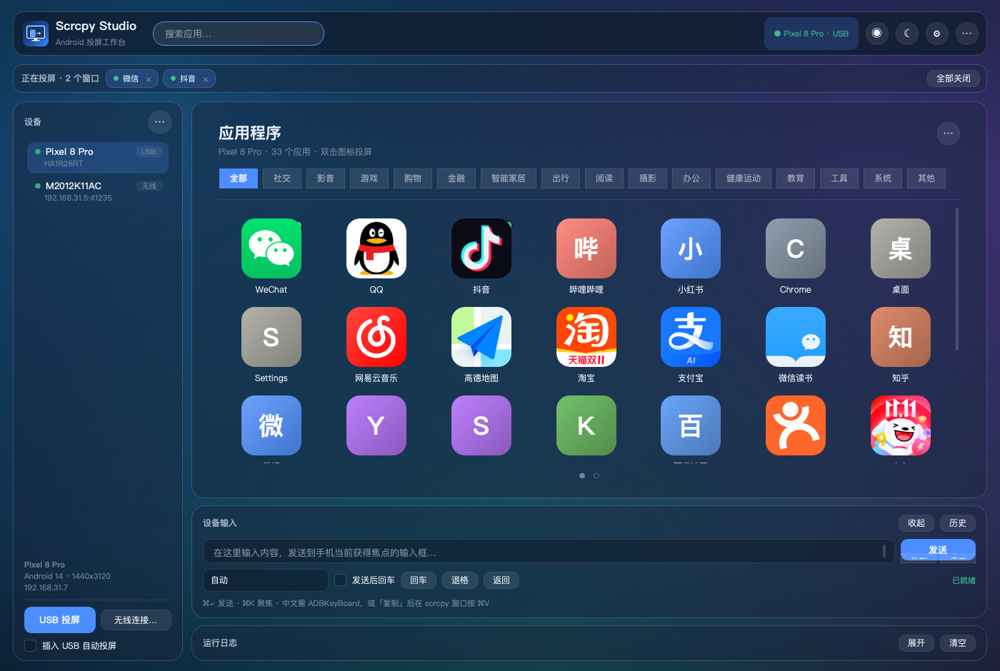
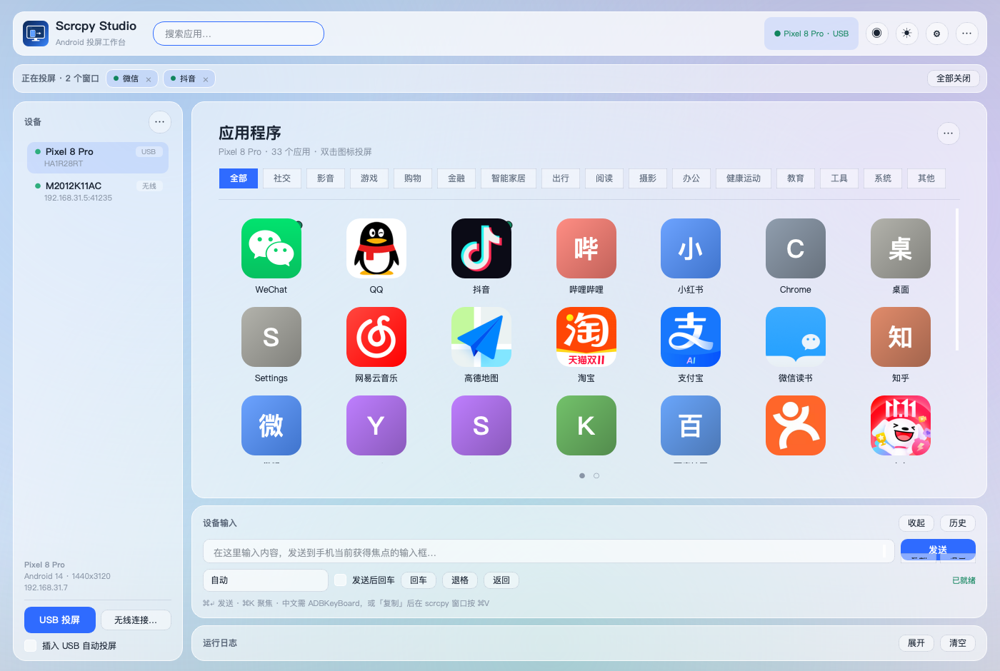
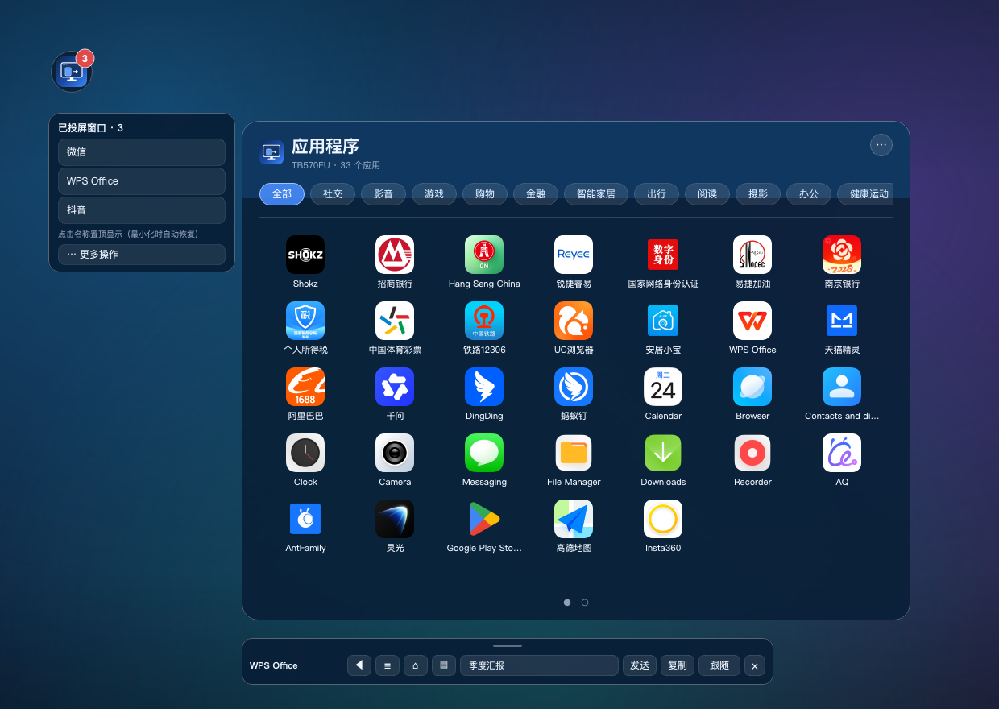
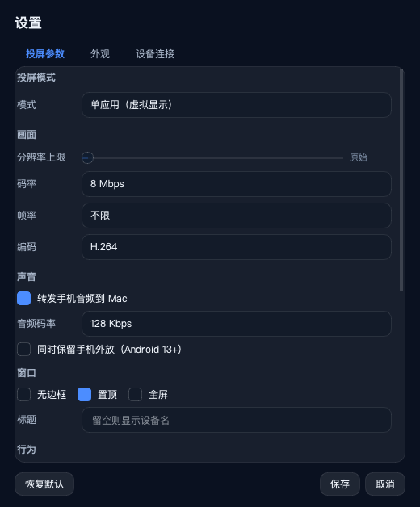
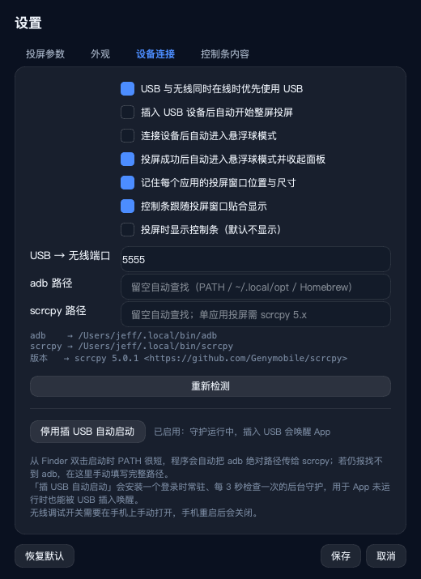
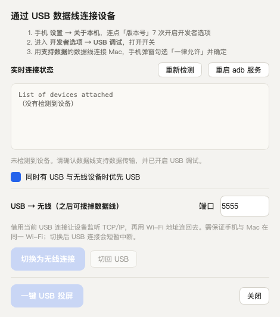
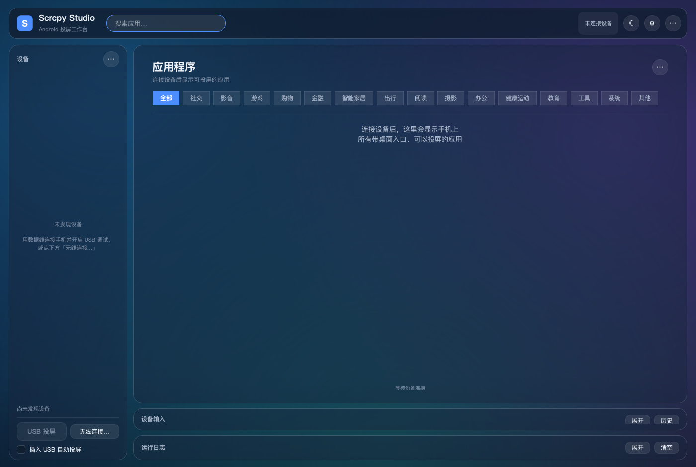
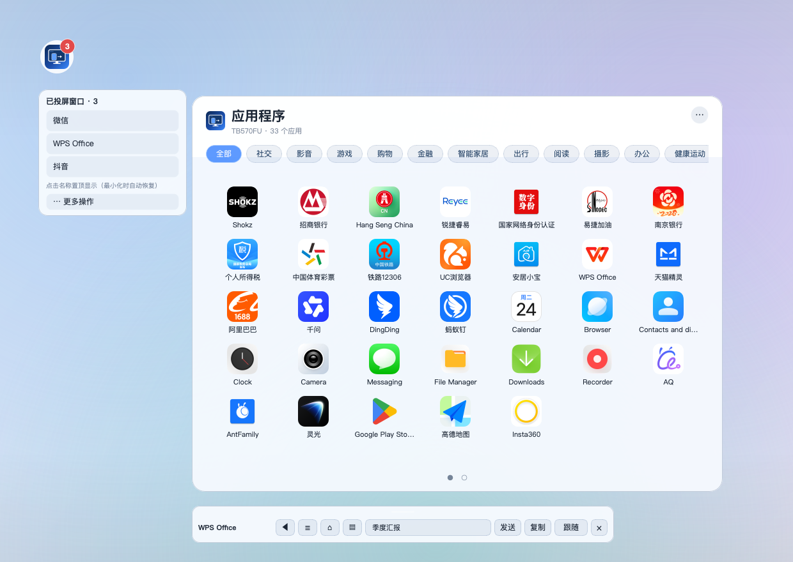

# Scrcpy Studio

macOS 桌面投屏工作台：集中管理 adb / scrcpy，用 **macOS Launchpad 风格**的网格浏览手机上所有可投屏的应用，
双击即在独立虚拟显示中单独投屏；支持 USB / 无线连接、深浅色毛玻璃主题、设备文本输入，以及**多个应用窗口同时投屏**；还可以收起为桌面悬浮球，点一下即展开应用列表。







<details>
<summary>更多界面预览</summary>











</details>

## 构建产物 · 直接下载

不想配 Python 环境的话，直接下载打好的 App，**解压后双击 `ScrcpyStudio.app` 即可**。
包内已内嵌 Python 3.13 运行时、PySide6（QtCore / QtGui / QtWidgets）、pyaxmlparser 与 lxml，
不依赖系统 Python，也不读写项目目录。

| 产物 | 体积 | 说明 |
|---|---|---|
| [ScrcpyStudio-0.6.1-macOS-arm64.app.zip](dist/ScrcpyStudio-0.6.1-macOS-arm64.app.zip) | 约 56 MB | **解压即用**，Apple Silicon / macOS 12+ |
| [ScrcpyStudio-0.6.1-macOS-arm64-source.tar.gz](dist/ScrcpyStudio-0.6.1-macOS-arm64-source.tar.gz) | 约 3 MB | 源码快照（含界面预览图与图标），按下方「环境准备」安装 |
| [app.zip.sha256](dist/ScrcpyStudio-0.6.1-macOS-arm64.app.zip.sha256) · [source.tar.gz.sha256](dist/ScrcpyStudio-0.6.1-macOS-arm64-source.tar.gz.sha256) | — | 校验文件 |

```bash
# 校验下载完整性
shasum -a 256 -c ScrcpyStudio-0.6.1-macOS-arm64.app.zip.sha256
# SHA256: 0b58c18169d117afe0566eb3b6a46425c64b3b3eb8a9e0acdfcdfd412444958c
```

首次打开若被 Gatekeeper 拦截（未做正式 Apple 签名，只有 ad-hoc 签名）：

```bash
xattr -cr ~/Downloads/ScrcpyStudio.app   # 或在 Finder 里右键 App → 打开
```

**仍需自备 `scrcpy`（5.x）与 `adb`** —— 两者不含在包内，装到 `~/.local/bin/` 即可，
程序会自动在 PATH、`~/.local/opt/`、Homebrew 路径下查找。Intel Mac 请用源码方式运行。

复现构建（产物写入 `dist/`，自动生成 SHA256）：

```bash
./scripts/build_app.sh
```

脚本会从 `.venv` 读取 Python 版本与依赖，把运行时和精简后的 Qt 嵌进 `.app/Contents/Resources`，
做 ad-hoc 签名，再用隔离 HOME + offscreen 启动自检，最后用 `ditto` 打包以保留符号链接与签名。

## 界面与交互

### 悬浮球模式

点工具栏「◉」、菜单「进入悬浮球模式」或 `⌘⇧F` 即可收起主窗口，桌面只留一个
始终最前的圆形悬浮球（显示 App 图标）。**左键**展开半透明 Launchpad 风格应用面板，
再点一次或点击别处收起；**右键**切换「已投屏窗口」列表；拖动小球可换位置，
位置会记住，面板会自动跟着小球选择展开方向。

> **置顶实现**：除 Qt 的置顶 flag 外，还会把悬浮球与面板的 macOS 原生窗口层级设为
> `NSScreenSaverWindowLevel+1`，并允许跨 Spaces / 全屏辅助显示；每秒重新断言一次，
> 切换应用、别的 App 进入全屏或系统重排窗口后仍保持在最前。

- 面板按小球所在屏幕与象限决定向左/右、向上/下展开，并 clamp 到屏幕可用区域，
  **始终保证 7 列 × 4 行的最小网格完整可见**（屏幕较小时自动缩小单元尺寸）。
- 面板包含标题、设备名 / 应用数、分类胶囊、分隔线与 7 列图标网格；
  **单击图标即在新窗口投屏**，仍可同时打开多个应用。
- 已投屏窗口列表底部的「⋯ 更多操作」（或应用面板「⋯」）：展开 / 收起、
  重新读取应用列表、显示主窗口、设置、退出悬浮球模式、退出程序。
- 设置 → 设备连接 勾选「连接设备后自动进入悬浮球模式」后，
  设备从离线变在线时会自动收起主窗口并切到悬浮球形态。

**投屏窗口管理（悬浮球形态）**

- **数字角标**：球右上角的红色数字显示当前投屏窗口数，随窗口启动/退出实时更新。
- **右键已投屏列表**：右键小球弹出半透明「已投屏窗口」列表，与应用面板互斥，
  再次右键或点击条目后收起（不再靠悬停自动弹出，避免误触）。
  **点击条目即把对应窗口置顶显示**；若窗口已最小化，会尝试取消 `AXMinimized` 恢复显示。
- **重复点击不重复投屏**：点击已在投屏中的应用不会再启动第二个 scrcpy 进程，
  而是尝试把已有窗口激活到前台，并收起应用面板；整屏投屏同理。
- **投屏成功后自动进入悬浮球模式并收起应用面板**（默认开启，
  设置 → 设备连接 可关闭）。从主窗口双击图标、或从悬浮球面板单击图标投屏都会自动切换。

> 窗口置前用 `NSRunningApplication` 激活 scrcpy 进程；若 macOS 拒绝焦点切换，
> 会再静默尝试 System Events。即使置前未生效，**也绝不会重复启动投屏**，
> 日志会提示手动点击该窗口，必要时在「系统设置 → 隐私与安全性 → 自动化」授权。


### 每个投屏窗口的控制条

scrcpy 窗口是独立进程，无法在其中嵌入按钮，因此每个投屏窗口都会自动配一个
**始终置顶、可拖动**的紧凑控制条（截图底部那条）：

| 控件 | 作用 |
|---|---|
| `◀` `☰` `⌂` `▤` | 向手机发送返回 / 菜单 / 主屏 / 最近任务按键（`adb shell input keyevent`） |
| 输入框 + `发送` | 把文字推送到手机当前获得焦点的输入框（复用「设备输入」的 ASCII / ADBKeyBoard 通道） |
| `复制` | 放到 Mac 剪贴板，再到 scrcpy 窗口按 `⌘V`（中文兜底，支持任意语言） |
| 窗口名 | 点击把该投屏窗口置前 |
| `×` | 只关闭这个投屏窗口 |
| `跟随` / `固定` | 切换控制条是否跟随投屏窗口贴合显示 |

控制条随窗口创建 / 销毁，拖动后的位置也会按应用记住。

### 记住每个应用的窗口位置

设置 → 设备连接 的「记住每个应用的投屏窗口位置与尺寸」默认开启。程序每 2 秒用
`CGWindowListCopyWindowInfo` 读取一次 scrcpy 窗口的实际位置与尺寸（公开 API，
不需要屏幕录制 / 辅助功能权限），窗口关闭时按**包名**写入 `config.json`。
下次投同一个应用时会自动带上 `--window-x/y/width/height`，并恢复控制条位置；
整屏投屏用 `__screen__` 作为键。关闭该开关即不再记忆、也不再恢复。

> 由于 `CGWindowList` 返回的是含标题栏的窗口外框，而 scrcpy 的 `--window-*` 设置的是内容区，
> 恢复后可能有几十像素的轻微偏差；窗口仍可自由拖动，下次采样会自动收敛。

### 控制条跟随投屏窗口

设置 → 设备连接 的「控制条跟随投屏窗口贴合显示」默认开启（可关）。程序每 **120 ms**
用一次 `CGWindowListCopyWindowInfo` **批量枚举所有投屏窗口**（单次约 1.7 ms，
约占 1.4% 单核；不是每个窗口枚举一次），把控制条贴在对应 scrcpy 窗口上方：

- 水平居中对齐窗口，上方空间不够时自动改贴下方，**不遮挡画面**；
  位置 clamp 到窗口所在屏幕的可用区域，多个窗口位置相近时自动错开控制条。
- 控制条宽度随窗口在 520–660 px 间自适应，窄窗口时自动收起次要按钮。
- 窗口最小化或切到别的 Space 导致读不到窗口时，连续 3 帧后隐藏控制条；
  窗口恢复显示时自动重新出现。
- **手动拖动控制条即解除跟随**（按钮变「固定」），位置按应用记住；
  点「跟随」按钮立刻贴回窗口。跟随模式下记忆的控制条位置不使用。

> 配合「设置 → 投屏参数 → 窗口」里 scrcpy 自带的**无边框**和**置顶**效果更好：
> 无边框后 CG 外框与内容区一致、没有标题栏偏差，置顶可减少「画面被盖住、
> 控制条仍飘在最前」的视觉穿帮。这两项都是 scrcpy 原生参数，本版本没有额外打包依赖。

> **边界**：这仍是两个进程、两类窗口（macOS 不允许跨进程设置父子窗口），
> 所以快速拖动时控制条会有约 120 ms 的跟随滞后，`Cmd+Tab`、全屏 Spaces、
> 系统最小化动画也不会与画面完全同步。要做到真正单窗口只能 fork 客户端或自研 Qt 客户端。

### 插 USB 自动启动 App

App 未运行时插入 USB 也想被唤醒，需要系统级守护（macOS 没有「USB 插入即启动」的 launchd 键）。
在 **设置 → 设备连接 → 启用插 USB 自动启动…** 里确认后，程序会安装
`~/Library/LaunchAgents/local.jeff.scrcpy-studio.usbwatch.plist`：登录时常驻、
每 3 秒用 `adb devices` 检查一次，检测到 USB 设备上线就 `open` 启动 App。
同一个按钮可随时「停用」，日志在 `~/Library/Logs/ScrcpyStudio-usbwatch.log`。

> 该守护由用户显式启用，安装 App 时不会自动写入；启用后会随账户登录常驻一个轻量后台进程。
> 若同时勾选「自动进入悬浮球模式」，插线后就会直接变成悬浮球形态。

### 首次连接与应用列表刷新

设备刚插上时 adb 可能尚未完成枚举 / 授权，读取应用列表会返回空。程序**不会把空结果缓存**：
会按 1.2s / 2.2s / 3.5s / 5s 自动重试 4 次，之后每次 15 秒轮询继续补读，
设备就绪后无需手动操作即可出现应用；界面会显示「等待设备就绪 · 第 N 次重试」。

两个刷新入口是分开的，不要混用：

| 入口 | 作用 |
|---|---|
| 更多菜单 → **重新读取应用列表** | 只重新查一次包名列表，**沿用本地名称/图标缓存**，很快 |
| 更多菜单 → **重新提取名称与图标（较慢）** | 清空 APK 信息缓存、逐个重新解析，仅在图标缺失或应用更新后用 |

名称与图标由后台线程分批回传，主界面网格只局部替换变化的图标 widget，
悬浮球面板在收起状态**不构建网格**，展开时才一次性生成，因此批量回传时界面依然流畅。
APK 路径用一条 `pm list packages -f` 批量取得，缓存命中直接返回，常规加载不会 pull 整包 APK。

### Launchpad 风格应用舞台

连接设备后，应用以 macOS「启动台」的形态展示，不再是早期版本的手机外框：

- 顶部大标题「应用程序」+ 设备名 / 应用数量，右侧「⋯」更多菜单
- 一行分类胶囊（全部 + 15 类），点击即筛选；下方细分隔线
- **自适应列数的大图标网格**（默认按窗口宽度计算，约 7 列），圆角方形图标、名称居中、单行省略
- 双击图标 → `scrcpy --new-display --start-app=+包名`，在独立虚拟显示里只投这一个应用
- 右键：投屏 / 复制包名 / 改显示名 / 固定到 Dock / 归类到… / 恢复自动分类
- 顶部搜索框可按应用名或包名实时过滤；「⋯」里可切换紧凑列表、应用来源、按类型分区

应用列表来自 `cmd package query-activities`，只保留真正带桌面入口的应用。
Android 的 shell 接口读不到 label / icon，程序会从设备端 APK 解析二进制
`AndroidManifest.xml` + `resources.arsc`（基于 `pyaxmlparser`）：优先走 `unzip -p` 轻量路径
（只取 manifest / resources.arsc / 图标），不支持时回退 `adb pull` 整包解析；
结果与图标 PNG 缓存在 `~/Library/Application Support/ScrcpyStudio/appinfo/`，3 线程并发、可强制重载。

### 毛玻璃主题：深色 / 浅色 / 跟随系统

- 工具栏「◐」按钮可切换 **跟随系统 / 浅色 / 深色**，设置对话框的「外观」页也能改，偏好会持久化
- 选择「跟随系统」时，通过 Qt 的 `colorSchemeChanged` 自动同步 macOS 外观切换
- 玻璃质感由柔和光斑壁纸 + 半透明材质层 + 亮边圆角叠加模拟（Qt 无原生 backdrop blur）
- 图标、文字、输入框、菜单、对话框全部随主题切换；应用网格列数可在设置里固定或自适应

### 设置菜单

主界面不再常驻参数面板。复杂项统一收进工具栏「⚙」（或 `⌘,`）打开的**设置对话框**，分三页：

| 标签页 | 内容 |
|---|---|
| 投屏参数 | 投屏模式、分辨率上限、码率、帧率、编码器、音频、窗口样式、行为、录制、虚拟显示尺寸/DPI |
| 外观 | 主题模式、Launchpad 网格列数 |
| 设备连接 | USB 优先、插入自动投屏、连设备/投屏后自动进入悬浮球、记住窗口位置、控制条跟随窗口、USB → 无线端口、adb/scrcpy 路径与环境自检、插 USB 自启守护 |

设备栏也精简为「设备列表 + USB 投屏 + 无线连接」，重启 adb、USB 连接向导、配对、
USB → 无线、断开等高级操作收进「⋯」菜单。

### 多窗口同时投屏

单进程限制已移除，改为按窗口 ID 管理的进程表：

- 每个应用一个 `scrcpy --new-display` 进程，**可以同时开多个互不干扰**（真机验证：2 个窗口分别创建 display id=6 / id=7）
- 顶部「正在投屏」条列出所有窗口，每个 chip 可单独关闭，右侧「全部关闭」一键收尾
- 正在投屏的应用在网格里有绿点角标；进程退出自动回收、刷新状态
- 同一台设备的**整屏投屏只允许一个**（避免重复），但不影响继续打开单应用窗口
- **同一应用重复点击只把已有窗口置前，不会新开窗口**；悬浮球角标与右键列表实时同步
- 退出程序时自动终止所有投屏进程

### 设备输入

底部「设备输入」把 Mac 上敲的文字推送到手机**当前获得焦点的输入框**：

| 模式 | 通道 | 适用 |
|---|---|---|
| 自动 | 纯 ASCII 走 `input text`，含中文走 ADBKeyBoard | 默认 |
| 仅英文 | `adb shell input text` | 空格转 `%s`，shell 层安全转义 |
| ADBKeyBoard | `am broadcast -a ADB_INPUT_B64 --es msg <base64>` | 中文 / emoji，需设备装 `com.android.adbkeyboard` |

支持「发送后回车」、回车 / 退格 / 返回键、最近 20 条历史；
「复制」把文本放进 Mac 剪贴板，到 scrcpy 窗口按 `⌘V` 即可粘贴任意语言。
面板可折叠，日志面板默认收起。

### 应用分组

内置 15 类规则：社交、影音、游戏、购物、金融、智能家居、出行、阅读、摄影、办公、
健康运动、教育、工具、系统、其他。匹配顺序为
**手动指定 > 精确包名表 > 关键词规则 > 系统应用 > 其他**。
分类胶囊一键筛选；「按类型分区」可在网格内按组分段显示；右键「归类到…」可覆盖并持久化。

## 连接方式

**USB（推荐先用这个）**：手机开「开发者选项 → USB 调试」→ 数据线连 Mac →
弹窗点「允许 USB 调试」→ 设备栏出现设备 → 点「USB 投屏」。
「USB 连接…」向导提供三步引导、实时 `adb devices -l` 状态、连接诊断、重启 adb 与一键投屏。

**无线（Android 11+，一次性）**：

1. 手机：开发者选项 → 无线调试 → 打开 → 「使用配对码配对设备」
2. App：设备栏「⋯」→ 无线配对 → 填弹窗里的地址和 6 位码
3. App：无线连接 → 填无线调试页面上的地址（和配对地址不同）
4. 成功后 App 会记住设备，之后只要无线调试开着，点「刷新」即可直连

**无线（Android 10 及以下）**：先 USB 连上，用「USB → 无线」切到 `adb tcpip 5555`，再拔线。

## 快捷键

| 快捷键 | 动作 |
|---|---|
| `⌘↵` / `Ctrl+↵` | 发送输入框内容到手机 |
| `⌘K` | 聚焦设备输入框 |
| `⌘F` | 聚焦应用搜索框 |
| `⌘,` | 打开设置 |
| `⌘U` | USB 整屏投屏 |
| `⌘⇧F` | 进入 / 退出悬浮球模式 |
| `Esc` | 清空当前获得焦点的输入框 / 搜索框 |

## 环境准备（从源码运行）

```bash
python3 -m venv .venv
.venv/bin/pip install -r requirements.txt
```

运行前需确保 `scrcpy`（5.x，需支持 `--new-display`）与 `adb` 可用，推荐装到 `~/.local/bin/`。
macOS 12+ / Apple Silicon 与 Intel 均可。

## 启动

使用构建产物时直接双击解压出的 `ScrcpyStudio.app`；从源码运行则：

```bash
open ScrcpyStudio.app   # 或双击（源码目录里的应用壳）
./run.sh                # 命令行
```

## 故障排查

### `ERROR: Could not execute "adb start-server"`

现象：设备和应用列表都能正常读出来，但一点投屏就立刻退出，日志出现：

```
ERROR: (make 'adb' accessible from your PATH or define its fullpath in the ADB environment variable)
ERROR: Could not execute "adb start-server"
ERROR: Could not start adb server
ERROR: Server connection failed
```

原因：从 Finder 双击 `.app` 时，进程只继承 launchd 的最小 `PATH`，不包含 `~/.local/bin`
或 Homebrew 路径。程序自身用**绝对路径**调用 adb（所以设备与应用列表正常），
但 scrcpy 是独立子进程，会在自己的 PATH 里找 adb，于是启动失败。

**0.3.1 起已修复**：启动 scrcpy 时自动注入 `ADB=<adb 绝对路径>`（scrcpy 官方支持的环境变量），
把 adb / scrcpy 所在目录补进子进程 PATH，并在需要时指定 `SCRCPY_SERVER_PATH`。

若仍然失败，到 **设置 → 设备连接** 手动填写 adb / scrcpy 的完整路径（留空为自动查找），
点「重新检测」能看到程序实际解析到的路径与版本：

```bash
which adb          # 例如 ~/.local/bin/adb
scrcpy --version   # 例如 scrcpy 5.0.1
```

### 单应用投屏失败 / 提示版本过旧

`--new-display` 与 `--start-app` 是 **scrcpy 5.0** 才加入的。检测到 4.x（如 `scrcpy 4.1`）时，
双击应用图标会询问是否降级为「整屏投屏 + 在手机上启动该应用」；
升级到 5.x 后即可恢复独立窗口与多窗口同时投屏。启动日志与设置页都会显示检测到的版本。

```bash
scrcpy --version                      # 先确认版本
brew upgrade scrcpy                   # Homebrew 版本可能停留在 4.x
# 或下载官方 macOS 预编译包，解压到 ~/.local/opt/scrcpy/（程序会自动查找）
```

### 首次连接后应用列表空白 / 刷新很卡

- 现在会自动重试（见「首次连接与应用列表刷新」）。若一直空白，先确认手机已解锁、
  已授权 USB 调试，再点「重新读取应用列表」。
- 以前「重新读取应用」会顺带清空全部图标缓存并对每个应用重新解析 APK，
  设备不支持 `unzip -p` 时还会逐个 pull 整包，导致长时间卡顿。该行为已拆分到
  「重新提取名称与图标（较慢）」，常规刷新不再触发。
- `pyaxmlparser` 解析部分 `resources.arsc` 时会刷大量 `res1 is not zero!` 警告，
  已提高该库日志级别到 ERROR，不再淹没输出。

## 已知限制

- 手机重启后无线调试默认关闭，App 无权替你打开（无 root / 无 Shizuku 的固有限制）。
- `input text` 只支持 ASCII；中文要么装 ADBKeyBoard，要么用剪贴板 + scrcpy `⌘V`。
- 首次连接设备后提取图标会占用一些时间（取决于应用数量与设备端是否有 `unzip`），之后走本地缓存。
- 毛玻璃是程序绘制的柔和光斑 + 半透明材质，不是系统级实时背景模糊。
- 构建产物为 ad-hoc 签名、面向 Apple Silicon；Intel Mac 请走源码方式。
  二进制产物会让仓库体积随版本增长，大版本建议改用 GitHub Release 附件或 Git LFS。
- 真机上「同时投多个应用窗口」依赖设备允许多虚拟显示；部分 ROM 可能有数量上限。
- 悬浮球使用高于系统屏保的原生窗口层级，会盖住菜单栏与部分系统浮层；
  展开的应用面板同样是置顶窗口，点击别处即收起。
- 「插 USB 自动启动」依赖 launchd 守护轮询（3 秒间隔），拔插后需等待一个检查周期。
- 「窗口置前 / 恢复最小化」属于尽力而为：macOS 可能拒绝非前台进程激活其他应用，
  取消 `AXMinimized` 的备用方式需要「系统设置 → 隐私与安全性 → 自动化 / 辅助功能」授权；
  失败时只会提示，不会重复投屏。
- 控制条是独立的置顶小窗口，不会嵌入 scrcpy 窗口内部；跟随模式下约 120 ms 的滞后无法消除，
  多个窗口位置相近时控制条会自动错开，也可各自拖动固定。
- 应用图标已缩到原来的 60%（主界面 84→50 px、悬浮球面板 78→48 px），
  列宽与 7 列布局保持不变。

## 目录结构

```
app.py                  入口
run.sh                  源码启动脚本
push.sh                 GitHub 推送脚本（走 443 端口）
requirements.txt        Python 依赖
ScrcpyStudio.app/       源码目录里的 macOS 应用壳
core/adb.py             adb 封装（设备 / 应用 / 连接 / 配对 / mDNS / USB 诊断）
core/usbwatch.py        track-devices 热插拔事件流
core/apkinfo.py         APK 名称与图标提取、轻量取数、本地缓存
core/categories.py      应用分组规则引擎
core/textinput.py       文本注入与 ADBKeyBoard 广播
core/config.py          参数建模与持久化
core/aliases.py         包名 → 中文名映射
core/tasks.py           线程池异步包装
core/paths.py           可执行文件查找、图标路径与子进程环境
core/usbautostart.py    插 USB 自启 LaunchAgent 管理
resources/              App 图标（AppIcon.png / AppIcon.icns）
ui/style.py             主题引擎（深浅色 / 毛玻璃 / 全局 QSS）
ui/launchpad.py         Launchpad 大图标网格与分类胶囊
ui/panels.py            设备栏 / 应用舞台 / 参数表单 / 日志
ui/settings_dialog.py   设置对话框（投屏 / 外观 / 连接）
ui/mirrorbar.py         多投屏窗口状态条
ui/floatball.py         悬浮球、跟随定位与半透明应用面板
ui/nativewindow.py      macOS 原生窗口层级、进程置前、单/批量窗口位置读取
ui/mirrorcontrol.py     每个投屏窗口的控制条
ui/inputpanel.py        设备输入面板
ui/dialogs.py           无线连接 / 配对对话框
ui/usbdialog.py         USB 连接向导
ui/main_window.py       主窗口、工具栏与多进程投屏管理
scripts/build_app.sh    自包含 App 构建脚本
scripts/make_icon.py    App 图标生成（PNG + icns）
scripts/usb_watch.sh    USB 自启守护脚本
scripts/verify_connect.py  首次连接与刷新性能回归自检
scripts/verify_mirror.py   投屏去重 / 角标 / 右键列表 / 自动进入悬浮球回归自检
scripts/verify_control.py  控制条 / 几何记忆 / 跟随 / 左右键 / 图标尺寸回归自检
scripts/shot*.py        离屏截图自检脚本
dist/                   构建产物（app.zip / source.tar.gz / SHA256）
```
