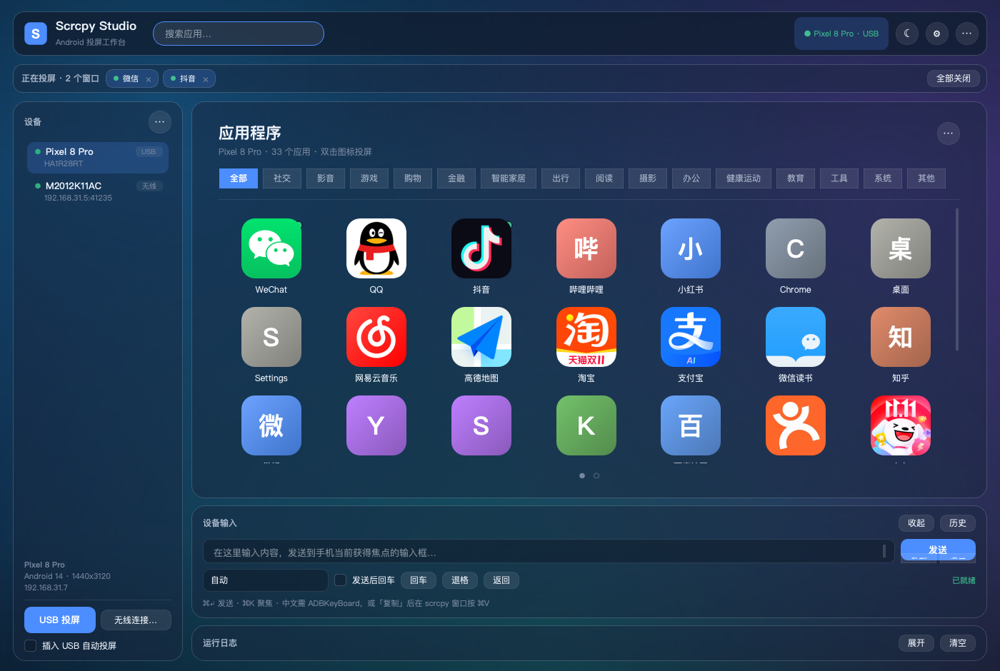
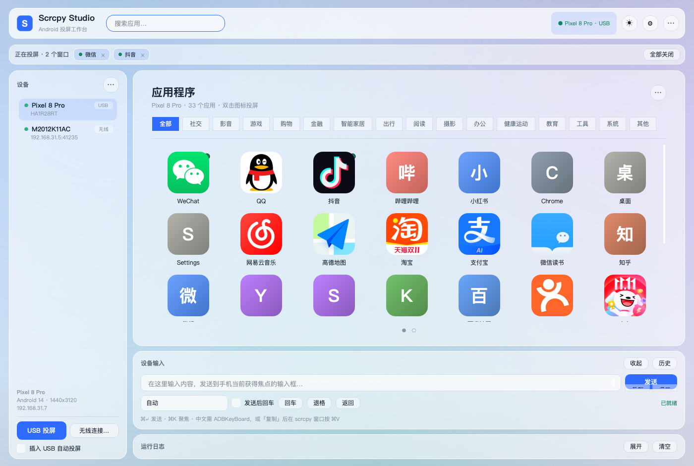
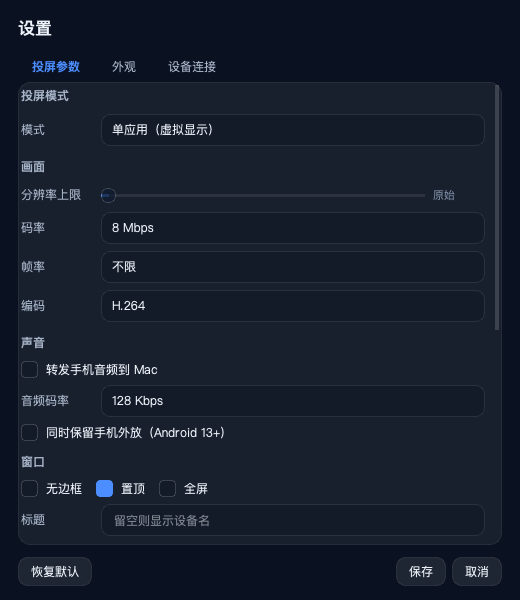

# Scrcpy Studio

macOS 桌面投屏工作台：集中管理 adb / scrcpy，用 **macOS Launchpad 风格**的网格浏览手机上所有可投屏的应用，
双击即在独立虚拟显示中单独投屏；支持 USB / 无线连接、深浅色毛玻璃主题、设备文本输入，以及**多个应用窗口同时投屏**。





<details>
<summary>更多界面预览</summary>




</details>

## 构建产物 · 直接下载

不想配 Python 环境的话，直接下载打好的 App，**解压后双击 `ScrcpyStudio.app` 即可**。
包内已内嵌 Python 3.13 运行时、PySide6（QtCore / QtGui / QtWidgets）、pyaxmlparser 与 lxml，
不依赖系统 Python，也不读写项目目录。

| 产物 | 体积 | 说明 |
|---|---|---|
| [ScrcpyStudio-0.3.0-macOS-arm64.app.zip](dist/ScrcpyStudio-0.3.0-macOS-arm64.app.zip) | 约 56 MB | **解压即用**，Apple Silicon / macOS 12+ |
| [ScrcpyStudio-0.3.0-macOS-arm64-source.tar.gz](dist/ScrcpyStudio-0.3.0-macOS-arm64-source.tar.gz) | 约 1.6 MB | 源码快照（含界面预览图），按下方「环境准备」安装 |
| [app.zip.sha256](dist/ScrcpyStudio-0.3.0-macOS-arm64.app.zip.sha256) · [source.tar.gz.sha256](dist/ScrcpyStudio-0.3.0-macOS-arm64-source.tar.gz.sha256) | — | 校验文件 |

```bash
# 校验下载完整性
shasum -a 256 -c ScrcpyStudio-0.3.0-macOS-arm64.app.zip.sha256
# SHA256: bf9fa80328a25fdb3b49ed45f9463476c56e572d002ecbe2e144ec5cf3925913
```

首次打开若被 Gatekeeper 拦截（未做正式 Apple 签名，只有 ad-hoc 签名）：

```bash
xattr -cr ~/Downloads/ScrcpyStudio.app   # 或在 Finder 里右键 App → 打开
```

**仍需自备 `scrcpy`（5.x）与 `adb`** —— 两者不含在包内，装到 `~/.local/bin/` 即可，
程序会自动在 PATH、`~/.local/opt/`、Homebrew 路径下查找。Intel Mac 请用源码方式运行。

复现构建（产物写入 `dist/`，自动生成 SHA256）：

```bash
./scripts/build_app.sh
```

脚本会从 `.venv` 读取 Python 版本与依赖，把运行时和精简后的 Qt 嵌进 `.app/Contents/Resources`，
做 ad-hoc 签名，再用隔离 HOME + offscreen 启动自检，最后用 `ditto` 打包以保留符号链接与签名。

## 界面与交互

### Launchpad 风格应用舞台

连接设备后，应用以 macOS「启动台」的形态展示，不再是早期版本的手机外框：

- 顶部大标题「应用程序」+ 设备名 / 应用数量，右侧「⋯」更多菜单
- 一行分类胶囊（全部 + 15 类），点击即筛选；下方细分隔线
- **自适应列数的大图标网格**（默认按窗口宽度计算，约 7 列），圆角方形图标、名称居中、单行省略
- 双击图标 → `scrcpy --new-display --start-app=+包名`，在独立虚拟显示里只投这一个应用
- 右键：投屏 / 复制包名 / 改显示名 / 固定到 Dock / 归类到… / 恢复自动分类
- 顶部搜索框可按应用名或包名实时过滤；「⋯」里可切换紧凑列表、应用来源、按类型分区

应用列表来自 `cmd package query-activities`，只保留真正带桌面入口的应用。
Android 的 shell 接口读不到 label / icon，程序会从设备端 APK 解析二进制
`AndroidManifest.xml` + `resources.arsc`（基于 `pyaxmlparser`）：优先走 `unzip -p` 轻量路径
（只取 manifest / resources.arsc / 图标），不支持时回退 `adb pull` 整包解析；
结果与图标 PNG 缓存在 `~/Library/Application Support/ScrcpyStudio/appinfo/`，3 线程并发、可强制重载。

### 毛玻璃主题：深色 / 浅色 / 跟随系统

- 工具栏「◐」按钮可切换 **跟随系统 / 浅色 / 深色**，设置对话框的「外观」页也能改，偏好会持久化
- 选择「跟随系统」时，通过 Qt 的 `colorSchemeChanged` 自动同步 macOS 外观切换
- 玻璃质感由柔和光斑壁纸 + 半透明材质层 + 亮边圆角叠加模拟（Qt 无原生 backdrop blur）
- 图标、文字、输入框、菜单、对话框全部随主题切换；应用网格列数可在设置里固定或自适应

### 设置菜单

主界面不再常驻参数面板。复杂项统一收进工具栏「⚙」（或 `⌘,`）打开的**设置对话框**，分三页：

| 标签页 | 内容 |
|---|---|
| 投屏参数 | 投屏模式、分辨率上限、码率、帧率、编码器、音频、窗口样式、行为、录制、虚拟显示尺寸/DPI |
| 外观 | 主题模式、Launchpad 网格列数 |
| 设备连接 | USB 优先、插入自动投屏、USB → 无线端口 |

设备栏也精简为「设备列表 + USB 投屏 + 无线连接」，重启 adb、USB 连接向导、配对、
USB → 无线、断开等高级操作收进「⋯」菜单。

### 多窗口同时投屏

单进程限制已移除，改为按窗口 ID 管理的进程表：

- 每个应用一个 `scrcpy --new-display` 进程，**可以同时开多个互不干扰**（真机验证：2 个窗口分别创建 display id=6 / id=7）
- 顶部「正在投屏」条列出所有窗口，每个 chip 可单独关闭，右侧「全部关闭」一键收尾
- 正在投屏的应用在网格里有绿点角标；进程退出自动回收、刷新状态
- 同一台设备的**整屏投屏只允许一个**（避免重复），但不影响继续打开单应用窗口
- 退出程序时自动终止所有投屏进程

### 设备输入

底部「设备输入」把 Mac 上敲的文字推送到手机**当前获得焦点的输入框**：

| 模式 | 通道 | 适用 |
|---|---|---|
| 自动 | 纯 ASCII 走 `input text`，含中文走 ADBKeyBoard | 默认 |
| 仅英文 | `adb shell input text` | 空格转 `%s`，shell 层安全转义 |
| ADBKeyBoard | `am broadcast -a ADB_INPUT_B64 --es msg <base64>` | 中文 / emoji，需设备装 `com.android.adbkeyboard` |

支持「发送后回车」、回车 / 退格 / 返回键、最近 20 条历史；
「复制」把文本放进 Mac 剪贴板，到 scrcpy 窗口按 `⌘V` 即可粘贴任意语言。
面板可折叠，日志面板默认收起。

### 应用分组

内置 15 类规则：社交、影音、游戏、购物、金融、智能家居、出行、阅读、摄影、办公、
健康运动、教育、工具、系统、其他。匹配顺序为
**手动指定 > 精确包名表 > 关键词规则 > 系统应用 > 其他**。
分类胶囊一键筛选；「按类型分区」可在网格内按组分段显示；右键「归类到…」可覆盖并持久化。

## 连接方式

**USB（推荐先用这个）**：手机开「开发者选项 → USB 调试」→ 数据线连 Mac →
弹窗点「允许 USB 调试」→ 设备栏出现设备 → 点「USB 投屏」。
「USB 连接…」向导提供三步引导、实时 `adb devices -l` 状态、连接诊断、重启 adb 与一键投屏。

**无线（Android 11+，一次性）**：

1. 手机：开发者选项 → 无线调试 → 打开 → 「使用配对码配对设备」
2. App：设备栏「⋯」→ 无线配对 → 填弹窗里的地址和 6 位码
3. App：无线连接 → 填无线调试页面上的地址（和配对地址不同）
4. 成功后 App 会记住设备，之后只要无线调试开着，点「刷新」即可直连

**无线（Android 10 及以下）**：先 USB 连上，用「USB → 无线」切到 `adb tcpip 5555`，再拔线。

## 快捷键

| 快捷键 | 动作 |
|---|---|
| `⌘↵` / `Ctrl+↵` | 发送输入框内容到手机 |
| `⌘K` | 聚焦设备输入框 |
| `⌘F` | 聚焦应用搜索框 |
| `⌘,` | 打开设置 |
| `⌘U` | USB 整屏投屏 |
| `Esc` | 清空当前获得焦点的输入框 / 搜索框 |

## 环境准备（从源码运行）

```bash
python3 -m venv .venv
.venv/bin/pip install -r requirements.txt
```

运行前需确保 `scrcpy`（5.x，需支持 `--new-display`）与 `adb` 可用，推荐装到 `~/.local/bin/`。
macOS 12+ / Apple Silicon 与 Intel 均可。

## 启动

使用构建产物时直接双击解压出的 `ScrcpyStudio.app`；从源码运行则：

```bash
open ScrcpyStudio.app   # 或双击（源码目录里的应用壳）
./run.sh                # 命令行
```

## 已知限制

- 手机重启后无线调试默认关闭，App 无权替你打开（无 root / 无 Shizuku 的固有限制）。
- `input text` 只支持 ASCII；中文要么装 ADBKeyBoard，要么用剪贴板 + scrcpy `⌘V`。
- 首次连接设备后提取图标会占用一些时间（取决于应用数量与设备端是否有 `unzip`），之后走本地缓存。
- 毛玻璃是程序绘制的柔和光斑 + 半透明材质，不是系统级实时背景模糊。
- 构建产物为 ad-hoc 签名、面向 Apple Silicon；Intel Mac 请走源码方式。
  二进制产物会让仓库体积随版本增长，大版本建议改用 GitHub Release 附件或 Git LFS。
- 真机上「同时投多个应用窗口」依赖设备允许多虚拟显示；部分 ROM 可能有数量上限。

## 目录结构

```
app.py                  入口
run.sh                  源码启动脚本
push.sh                 GitHub 推送脚本（走 443 端口）
requirements.txt        Python 依赖
ScrcpyStudio.app/       源码目录里的 macOS 应用壳
core/adb.py             adb 封装（设备 / 应用 / 连接 / 配对 / mDNS / USB 诊断）
core/usbwatch.py        track-devices 热插拔事件流
core/apkinfo.py         APK 名称与图标提取、轻量取数、本地缓存
core/categories.py      应用分组规则引擎
core/textinput.py       文本注入与 ADBKeyBoard 广播
core/config.py          参数建模与持久化
core/aliases.py         包名 → 中文名映射
core/tasks.py           线程池异步包装
core/paths.py           可执行文件查找
ui/style.py             主题引擎（深浅色 / 毛玻璃 / 全局 QSS）
ui/launchpad.py         Launchpad 大图标网格与分类胶囊
ui/panels.py            设备栏 / 应用舞台 / 参数表单 / 日志
ui/settings_dialog.py   设置对话框（投屏 / 外观 / 连接）
ui/mirrorbar.py         多投屏窗口状态条
ui/inputpanel.py        设备输入面板
ui/dialogs.py           无线连接 / 配对对话框
ui/usbdialog.py         USB 连接向导
ui/main_window.py       主窗口、工具栏与多进程投屏管理
scripts/build_app.sh    自包含 App 构建脚本
scripts/shot*.py        离屏截图自检脚本
dist/                   构建产物（app.zip / source.tar.gz / SHA256）
```
