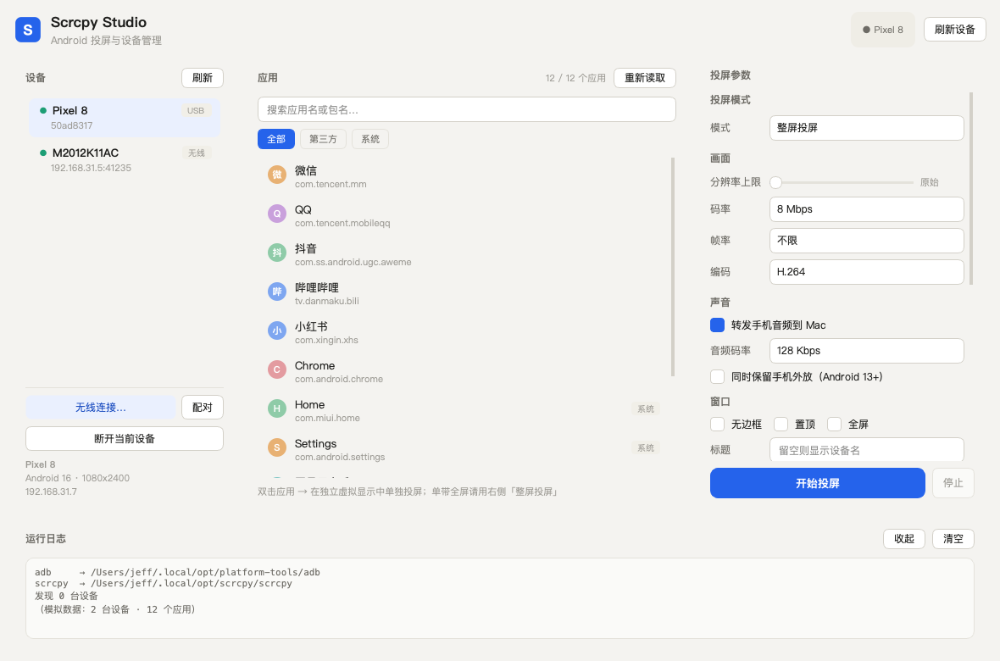

# Scrcpy Studio

macOS 桌面程序：集中管理 adb / scrcpy，浏览手机上所有可投屏的应用，双击即在独立虚拟显示中单独投屏。

## 启动

```bash
# 方式一：双击 App 壳
open ScrcpyStudio.app

# 方式二：命令行
./run.sh
```



## 环境准备

```bash
python3 -m venv .venv
.venv/bin/pip install -r requirements.txt
```

运行前需确保 `scrcpy`（5.x，需支持 `--new-display`）与 `adb` 可用，推荐装到 `~/.local/bin/`；
程序会自动在 PATH、`~/.local/opt/`、Homebrew 路径下查找。macOS 12+ / Apple Silicon 与 Intel 均可。

## 功能

- **设备管理**：自动发现 USB / 无线设备（5 秒轮询），显示型号、Android 版本、分辨率、IP；
  内置「无线连接」「配对（Android 11+）」对话框，支持 mDNS 局域网扫描。
- **应用列表**：通过 `cmd package query-activities` 只列出带桌面入口的应用（即真正可启动投屏的），
  支持搜索、全部/第三方/系统筛选、右键复制包名、右键自定义显示名称。
- **单应用投屏**：双击应用 → `scrcpy --new-display --start-app=+包名`，在独立虚拟显示中只投这一个应用
  （应用列表数据来自设备端，无需 root）。
- **整屏投屏**：经典模式，参数面板可调 码率/分辨率上限/帧率/编码器/音频/窗口形态/键盘鼠标模式/
  熄屏投屏/保持唤醒/录制 MP4 等，全部映射到 scrcpy 5.x 的命令行参数。
- **运行日志**：adb 与 scrcpy 的实时输出会打进底部控制台，方便排错。

## 无线连接流程（Android 11+，一次性）

1. 手机：开发者选项 → 无线调试 → 打开 → 「使用配对码配对设备」
2. App：设备栏 → 配对 → 填弹窗里的地址和 6 位码
3. App：设备栏 → 无线连接 → 填无线调试页面上的地址（和配对地址不同）
4. 成功后 App 会记住设备，之后只要无线调试开着，点「刷新」即可直连

## 已知限制

- 手机重启后无线调试默认关闭，App 无权替你打开（无 root / 无 Shizuku 的固有限制）。
- 应用列表的中文别名来自内置词典 + 用户自定义，未收录的应用显示包名。
- 未做代码签名，首次 `open` 如果被 Gatekeeper 拦截：右键 App → 打开。

## 目录结构

```
app.py              入口
run.sh              启动脚本
requirements.txt    Python 依赖（PySide6-Essentials）
ScrcpyStudio.app/   macOS 应用壳（双击启动）
core/adb.py         adb 封装（设备/应用/连接/配对/mDNS）
core/config.py      参数建模与持久化（~/Library/Application Support/ScrcpyStudio/）
core/aliases.py     包名 → 中文名映射
core/tasks.py       线程池异步包装
ui/panels.py        三栏面板与自定义委托
ui/dialogs.py       无线连接/配对对话框
ui/main_window.py   主窗口与业务接线
scripts/            离屏截图自检脚本
```
